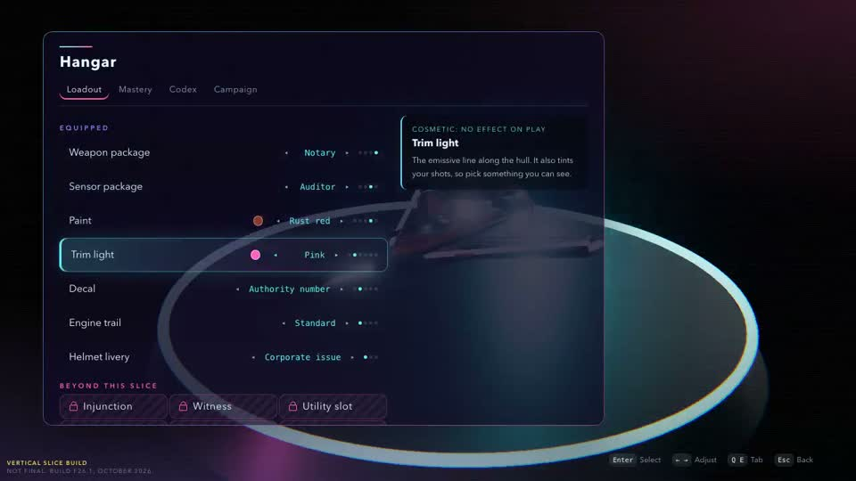

# Casual Creators hangar (October 28, 2026)

## Framing question

Adam's playtest: in the hangar he cannot see his ship behind the menu, and he
cannot see what the engine trail looks like. He asked us to channel Kate
Compton's Casual Creators. What would a hangar look like if it were a casual
creator first and a settings menu second, while staying inside the slice,
honest about its walls, legible to students, and playable on a portrait phone
and a managed school Chromebook?

Disciplines in play: creativity support tools (HCI), procedural generation
and possibility-space design, color science (perceptual palettes), game UI
and camera direction, and a little political economy (who gets to repaint
an Authority-issued ship, and why that must never be for sale).

## Sources

Primary, read this session (PDF text extracted locally, then trimmed):

- [CC15] Kate Compton and Michael Mateas, "Casual Creators", Proceedings of
  ICCC 2015, pp. 228–235.
  <https://www.computationalcreativity.net/iccc2015/proceedings/10_2Compton.pdf>
  Definition (p. 229): "A Casual Creator is an interactive system that
  encourages the fast, confident, and pleasurable exploration of a
  possibility space, resulting in the creation or discovery of surprising
  new artifacts that bring feelings of pride, ownership, and creativity to
  the users that make them."

Secondary, from prior knowledge, not re-fetched this session (galaxykate.com
returned HTTP 500 and eScholarship 403 today; verify before quoting):

- [KC19] Kate Compton, _Casual Creators: Defining a Genre of Autotelic
  Creativity Support Systems_, PhD dissertation, UC Santa Cruz, 2019.
- [TR15] Compton, Kybartas, Mateas, "Tracery: An Author-Focused Generative
  Text Tool", ICIDS 2015 (grammars as authored possibility spaces).
- [GEN16] Compton, "So you want to build a generator" (2016 essay): the
  "1000 bowls of oatmeal" problem (also in CC15 p. 230) and the advice to
  list the qualities every output must have, then constrain toward them.
- [GM13] Compton, Osborn, Mateas, "Generative Methods", FDG PCG workshop
  2013 (cited in CC15 for "large possibility spaces of valid-yet-surprising
  artifacts").
- Game precedents (author's knowledge of the shipped games): Spore Creature
  Creator, Animal Crossing: New Horizons custom designs, Splatoon gear and
  lobby showcase, Forza livery editor, Armored Core VI assembly and test,
  No Man's Sky starship customization, Picrew, Townscaper.

## Pattern list

Each pattern: what it is, where it comes from, what it asks of our hangar.

| # | Pattern | Source | Asks of the hangar |
|---|---|---|---|
| P1 | **Instant feedback**: the change is visible on the artifact immediately, and the system visualizes consequences the user would otherwise have to simulate mentally | CC15 p. 230 | The ship must be visible while choosing. Focus (not confirm) previews. |
| P2 | **Simulation as feedback**: when the artifact is judged by behavior over time, show a proxy simulation. CC15's BotPrint intervention put the robots in an arena because chassis changes "felt meaningless" when unseen (p. 233) | CC15 pp. 230, 233 | A test-flight vignette. This is exactly Adam's trail complaint: the trail only exists in motion. |
| P3 | **Chorus line**: when choosing among a space, overlay many variants so differences pop | CC15 p. 230 (Spore internal tool) | Ghost-overlay all sensor cones at once, current one bright; show the three Writ sizes side by side. |
| P4 | **Entertaining evaluations**: feedback need not be accurate to be motivating; Spore creatures laugh or shake at new parts | CC15 p. 231 | The ship reacts (thruster puff, settle bounce); the Authority logs "non-standard livery" in a dry voice. |
| P5 | **No blank canvas**: start from a shape or prompt, so the first move is accept or discard | CC15 p. 231 | Never open on empty; open on the issued livery plus a one-tap "Requisition a look" suggestion. |
| P6 | **Limiting actions / modal interaction**: few, clear choices per mode; unlock gradually | CC15 p. 231 | Two modes, Loadout (play) and Livery (look); one category open at a time; walled slots visible but quiet. |
| P7 | **Mutant shopping**: offer nearby alternatives; browsing is the pleasure, not optimization | CC15 p. 232 (Picbreeder, Dryad, Sentient Sketchbook) | Randomize and Mutate, with a strip of 3 nearby mutants to pick from. |
| P8 | **Modifying the meaningful**: controls map to high-level, perceptual changes, not raw parameters | CC15 p. 232 (Spore morph handles) | Palettes and "wear" rather than hex fields; package names describe a temperament ("sees everything, commits slowly"). |
| P9 | **Saving and sharing in plain formats** outside the app; Spore hid creatures in PNGs | CC15 p. 232 | A copyable share code; named presets. No network (school and privacy constraint). |
| P10 | **Hosted communities, ancestry** | CC15 p. 232 | Beyond the slice. Stub honestly. |
| P11 | **Valid-yet-surprising; avoid 1000 bowls of oatmeal** | CC15 p. 230, GEN16, GM13 | Generated palettes must be both always-good and actually different. |
| P12 | **Curated, constrained space where everything looks good** | Picrew, Townscaper (no fail state), Tracery's authored grammars | Every reachable combination is art-directed; rules, not freedom, guarantee quality. |
| P13 | **Pinning and locking** | Coolors-style palette tools, NMS and Forza preset workflows (author's knowledge) | Pin a row; Randomize and Mutate leave pinned rows alone. |
| P14 | **History and undo**: "rapid, incremental, reversible operations" | CC15 p. 233 quoting Shneiderman's direct manipulation | Undo/redo stack so randomizing is never a loss. |
| P15 | **Test before commit** | Armored Core VI garage test against dummies (author's knowledge) | The vignette fires the actual package numbers at a dummy. |
| P16 | **Share codes people can say aloud** | Animal Crossing Creator and design IDs (author's knowledge) | Our code is word tokens kids can read across a classroom. |
| P17 | **Showing off** | Splatoon lobby showcase, Forza storefront | A "Look" button hides all UI for a clean beauty shot; the ship appears with your livery in gameplay and the ending. |
| P18 | **Delight over efficiency** | KC19 theme; Spore | Small reveal animations and sounds per change, kept short (under 300 ms) so they never block. |

## Audit of the current hangar

Evidence: `src/ui/screens/hangar.ts`, `src/ui/frontend.css:1725–1760`,
`src/render/stage.ts:1106–1141`, and a frame from
`research/2026-10-28-moments/captures/hangar/capture.mp4`
(saved as `current-hangar.jpg` here).



What works (keep):

- **Data-as-contract** is well architected. `src/contracts/loadout.ts`
  keeps package numbers as data the sim reads and the UI draws as stat
  bars, with no duplicated tuning, and cosmetics are carried by the sim but
  never read (a clean pay-to-win firewall by construction). `inSlice:
  false` packages fall back to `standard` so stale saves cannot crash a
  run. This is the Single Source of Truth pattern done right.
- Focus previews live (`apply` on adjust), with stat deltas against the
  equipped package and a "Cosmetic: no effect on play" kicker. That is P1
  and P8 in text form.
- Walls are confident ("Beyond this slice" chips), per Framing.
- Distinct sounds exist: `hangar_equip`, `hangar_cosmetic`,
  `hangar_locked` (`src/audio/gameplaySounds.ts:250–262`).

What fails:

| Finding | Pattern violated | Severity |
|---|---|---|
| The panel is `min(60em, 66vw)` wide and the aside sits on top of the ship. In the capture the hull is a sliver behind the "Trim light" description; the pad ring dominates instead. On a portrait phone the panel will cover the ship entirely. | P1, P17 | Blocker |
| The hangar ship is static on its pad. The trail emitter only runs in gameplay (`stage.ts:763`), so trail choices are pure text. | P2 | Blocker (Adam's report) |
| Weapon and sensor packages show only stat bars. "Stream rate 8.6/s" and "cone 0.62 rad" ask the player to simulate mentally, the exact BotPrint failure. Young players cannot read radians. | P2, P3, P15 | High |
| Seven left-right cyclers, one value at a time: you cannot see the space, only a dot count. | P3, P7 | Medium |
| Paint is five fixed colors, trim six; nothing guarantees a pairing is good (rust red with red trim is mud; matte black hull with violet trim is low contrast against the lane). | P11, P12 | Medium |
| No randomize, mutate, pin, undo, presets, or share. | P5, P7, P9, P13, P14 | Medium |
| Mastery, Codex and Campaign share a tab bar with Loadout, so the creator mode is diluted by progression bookkeeping. | P6 | Low |
| Trim "also tints your shots": a cosmetic that affects readability. Not pay-to-win, but a readability risk if trim matches enemy bullet hues. | fairness | Medium |

## Redesign spec

### Principles in one line each

1. The ship is the hero: UI never covers its silhouette.
2. Choosing is seeing: focus previews on the ship and in the vignette.
3. Every reachable look is good; randomness is safe because undo exists.
4. Play-affecting choices are demonstrated, not just numbered.
5. Expression is a story beat, never a purchase.

### Layout

Two modes as a segmented control, **Loadout** (weapon, sensor) and
**Livery** (paint, trim, decal, trail, helmet). Mastery, Codex, Campaign
move to a secondary "Records" row (or stay as tabs, but default to Livery
or Loadout). One category is open at a time (P6).

Landscape (desktop, Chromebook 1366x768):

```
+--------------------------------------------------------------------------+
| < Back   HANGAR        [Loadout | Livery]               [Look] [Records] |
+-----+------------------------------------------------------+-------------+
| Pnt |                                                      | TRIM LIGHT  |
| Trm |                  ___                                 | Cosmetic:   |
| Dcl |             ____/ ^ \____      (hero 3D ship,        | no effect   |
| Trl |            <___ |   | ___>      centered, 3/4 view,  | on play     |
| Hlm |                 \___/           ~55% of width)       |             |
|     |                  |||                                 | [pin] Pink  |
| --- |                  ||| trail                           |             |
| [P] |                  |||                                 | (collapses  |
| [P] |   . . . . . . . . . . pad . . . . . . . . . . .      |  to a tab)  |
| [P] +------------------------------------------------------+             |
|  ^  | TEST FLIGHT  [ship strafes, trail streams, fires     |             |
| pre | stream / tap / Writ L1-L3 at a dummy, scan cone]     |             |
| sets+------------------------------------------------------+-------------+
| [Undo] [Redo]   [ swatch ][ swatch ][*swatch*][ swatch ][ swatch ]  [..] |
| [Randomize] [Mutate]  mutants: [m1] [m2] [m3]        Code: NW1-NOT-...   |
+--------------------------------------------------------------------------+
```

- Left rail: category icons with labels (48 px touch targets), a pin dot
  per row, and three preset slots below (plus walled slots).
- Right card: description and stat comparison; collapses to a slim tab.
- Bottom tray: the options for the open category as a **swatch strip**
  (all options visible at once, P3), then the creative verbs.
- The camera frames the ship into the free rectangle (the "safe frame"),
  computed from the layout rather than fixed (see render work).

Portrait (phone, a vertical shmup's natural orientation):

```
+---------------------------+
| < Back  HANGAR     [Look] |
| [ Loadout | Livery ]      |
+---------------------------+
|           ___             |
|      ____/ ^ \____        |   hero ship, top ~50%
|     <___ |   | ___>       |   (test flight plays
|          \___/            |    in this same view:
|           |||  trail      |    ship lifts, strafes,
|   . . . .pad. . . . .     |    fires up-screen)
+---------------------------+
| (Pnt)(Trm)(Dcl)(Trl)(Hlm) |   category chips, scroll
+---------------------------+
| TRAIL: Ion   [pin]        |
| [std][*ion*][ember][ghost]|   swatch strip
| no effect on play         |
+---------------------------+
| [Undo][Rand][Mutate][...] |   ... = presets, code
+===== drag handle =========+   sheet collapses to
                                this bar for a clean view
```

Safe areas: tray padded by `env(safe-area-inset-bottom)`. The bottom sheet
has three detents (closed bar, half, full); full is only for presets and
share code.

### The test flight vignette (P2, P3, P15)

Recommendation: **phase 1 is render-only, phase 2 is sim-driven.**

Phase 1 (cheap, fixes the playtest): when a category is focused, the hangar
ship lifts 0.3 units off the pad and plays a short looping routine in the
same scene, framed by a `hangarFlight` camera shot.

| Focused category | Routine (about 3 s loop) |
|---|---|
| Trail | Ship strafes left-right at gameplay speed so the trail streams and curls; a brief boost shows the trail's peak state. |
| Paint, decal | Slow 3/4 turn with a light sweep across the hull; decal faces camera at the midpoint. |
| Trim | Trim lights flicker on in sequence; one stream volley fires so the tinted shots are visible. |
| Helmet | Camera cuts to a cockpit-glass close-up of the Pilot figure (`pilot_figure` prop already swaps by helmet). |
| Weapon | Fires at a training dummy (an Authority drone silhouette on a range ahead of the pad): 4 taps, 1.5 s hold stream, then rest and release a Writ, with the L1–L3 charge glow timed from `chargeTicks`. |
| Sensor | Projects the scan cone onto the floor from `coneHalfAngle` and `range`, dwells on the dummy, and fills a lock ring over `lockTicks`. |

All timings read the real numbers from `WEAPON_PACKAGES` and
`SENSOR_PACKAGES`, so the demo is a visual proxy that cannot drift from
tuning. CC15 says the evaluation only needs to give a perception of
progress (p. 231); phase 1 is that.

Chorus line overlays:

- Sensor: all in-slice cones drawn at once as faint outlines, the focused
  one solid, the equipped one dashed. A child sees "wide and short" versus
  "narrow and long" in one glance, no radians.
- Weapon: three Writ silhouettes at L1, L2, L3 sized by `writRadius`, the
  equipped package ghosted behind.

Phase 2 (later, higher fidelity): run a tiny deterministic `sim` instance
with one dummy and scripted input (the same input recording format the
autopilot uses), rendered through the normal stage. This is BotPrint's
arena, and it also gives QA a free regression scene. Only do this if the
sim is cheap to instantiate twice; phase 1 is enough for the slice.

### Side-by-side for gameplay packages

On focus of a non-equipped package, the right card shows two columns,
**Equipped** and **Trying**, with plain-language bars a young player can
read: "Stream: fast / faster", "Writ hits: hard / very hard", "Writ ready
in: 2.0 s / 2.5 s", "Scan: wide, slow lock". Numbers stay available in a
small secondary line for older players and students reading the source.
The vignette plays the Trying package; a small "A/B" toggle replays the
equipped one. No package is strictly better: the existing tradeoffs
(`magistrate` slower stream, `surveyor` slower lock) are the point, and the
card names the tradeoff in one sentence ("sees everything, commits slowly").

### Palettes that always look good (P8, P11, P12)

Replace independent paint and trim cyclers with a **palette generator** in
OKLCH (perceptually uniform, so hue rotations keep apparent brightness),
while keeping the existing enum ids as the curated named palettes.

- A livery color state is `{ hullHue, hullTone, trimHue, harmony }`, where
  `harmony` is one of complementary, split, analogous, triad, mono.
- Constraints (the "qualities every output must have", GEN16):
  - Hull lightness in [0.18, 0.92], chroma at most 0.12 (hulls read as
    painted metal, not candy).
  - Trim lightness at least 0.75 and chroma at least 0.14 (emissive must
    glow against the lane at every tier).
  - Hull–trim lightness difference at least 0.35 (no mud).
  - **Readability guard**: trim hue at least 40 degrees from the enemy
    bullet hues in `PALETTE`, and the colorblind setting maps through the
    same check. This is the one rule that touches play, and it is a floor,
    not an advantage.
- Randomize picks a harmony and hull, derives trim from the harmony, and
  rejects samples that break a constraint (rejection sampling is legible
  for students and cheap).
- The five authored paints and six trims become named presets inside this
  space ("Authority White / Cyan" etc.), so nothing existing breaks.
- Anti-oatmeal: Randomize must not return a palette within a small OKLCH
  distance of the last five results.

Contract impact: `Cosmetics.trimColor` is already free-form `#rrggbb`;
`paint` is an enum. Either add an optional `hullColor: string` alongside
`paint` (paint stays as the material and name) or keep paint enumerated and
only generate trims for the slice. Recommendation: add `hullColor`, since
the sim ignores cosmetics anyway and replays just carry it.

### Randomize, mutate, pin, undo

- **Randomize** (fiction: "Requisition"): rerolls every unpinned livery
  row; in Loadout mode it rerolls packages too, behind the same pins.
- **Mutate** (fiction: "Tinker"): changes one or two unpinned fields by a
  small step (hue rotate 15–30 degrees, next decal, adjacent trail). Shows
  three mutants as small chips; hovering or focusing a chip previews it on
  the ship; selecting adopts it (mutant shopping, P7).
- **Pin**: a pin toggle on each row and in the card. Pinned rows show a
  small clamp icon on the swatch strip.
- **Undo / Redo**: a stack of `Loadout` snapshots (cap 50), pushed on every
  committed change (adjust, randomize, mutate, preset load, code paste).
  Keyboard Z and Shift+Z (and Ctrl variants), gamepad L3 or a face button
  in the tray, visible buttons for touch. Undo history is session-only.
- **Reset to issue**: one button returns to `DEFAULT_LOADOUT` (itself
  undoable).

### Presets and share code (P9, P16)

- Three named preset slots in the slice, saved in `progress` (localStorage,
  no network, no telemetry). Two more visible and walled.
- Share code: human-readable tokens, sayable aloud in a classroom,
  versioned and checksummed:

  ```
  NW1-NOT-AUD-RST-PNK-TAL-ION-WRN-K
  ver wpn sen hull trim decal trail helm check
  ```

  Generated hull and trim colors encode as a short base32 hue/tone pair
  instead of a word when they are not a named preset (`H7Q`). Decoding is
  total: unknown or out-of-slice tokens fall back to `standard`, the same
  rule as `weaponStats`, and a bad checksum shows "That code has a typo"
  rather than failing silently. Copy uses the Clipboard API with a visible
  selectable text fallback (managed Chromebooks may block clipboard).
- Codes contain only loadout choices: no names, ids, or timestamps.

### Fiction: issued versus personal, without pay-to-win

- The ship arrives in **Authority issue** (white, Authority number decal,
  corporate-issue helmet). The hangar shows a faint "Issued livery" stamp.
  Any personal change flips the stamp to "Personal repaint", and the
  Authority logs it in one dry line (P4): "Livery deviation noted. It has
  no effect on your rating." That line is both a joke and a policy
  statement: expression is free.
- Helmet: `corporateIssue` early; `worn` unlocks from the story (it is the
  same helmet after the contract), not from pay; `repainted` unlocks after
  the ending or the pacifist run, as the Pilot's one act of self-authorship.
  Open question for Adam (see below).
- Decals carry the narrative: `tallyMarks` could count enemies disarmed
  rather than destroyed, so a pacifist run leaves a mark on the hull.
- Nothing cosmetic is gated by the pay multiplier. Mastery may unlock looks
  (that is play), never packages with better numbers than standard.
- Contract rule kept and stated in the UI copy: cosmetics are never read by
  the sim. Add a sim test that asserts identical outcomes for two runs that
  differ only in cosmetics.

### Showing off (P17)

- **Look** button (and V key, and a two-finger tap) hides all UI for a beauty
  shot with slow orbit; any input returns. This doubles as the portrait
  "see my ship" escape hatch.
- The livery appears in the launch shot, gameplay, the flashback cockpit,
  and the ending, so the choice pays off in the story.

## Implementation split by owner

Owners follow `docs/WAVE3.md` (G, V, A, U) plus QA. Agent C is editing
`src/ui` and `src/render` now: sequence this after C lands.

**G Gameplay / contracts (`src/contracts/loadout.ts`, `src/sim/`, tests)**

1. Optional `hullColor` in `Cosmetics` (or decide against; see Open).
2. `encodeLoadout` / `decodeLoadout` (share code) as pure functions next to
   the contract, with a round-trip property test and fallback test.
3. Sim test: cosmetics-only differences produce identical runs.
4. Phase 2 only: a `createTestRange(loadout, script)` sim entry point.

**U UI (`src/ui/screens/hangar.ts`, `src/data/hangar.ts`, `src/i18n/ui.ts`, `frontend.css`)**

1. New layout: rail, swatch strip, collapsible card, bottom sheet in
   portrait, visible Back, 48 px targets; publish the free rectangle to V
   via a new hook `setHangarFrame(rect)`.
2. Modes Loadout and Livery; Records row for Mastery, Codex, Campaign.
3. `src/data/palette.ts`: OKLCH helpers, harmony rules, constraints,
   rejection sampler, anti-oatmeal memory (pure, unit-tested).
4. History stack, pins, Randomize, Mutate with three mutant chips, Reset.
5. Presets in `ProgressStore`; share code field with copy and paste.
6. Side-by-side stat card in plain language; i18n EN, ES, ZH for all new
   strings (pass `qa/` translation coverage).
7. Hooks to V: `previewLoadout` (focus, not committed) versus
   `applyLoadout` (committed); `setHangarFocus(category)` drives the
   vignette routine.

**V Render (`src/render/stage.ts`, `cameraRig.ts`)**

1. `hangar` shot frames the ship into the UI's free rectangle (fit the
   ship's bounding sphere to the rect, offset the target), portrait aware.
2. Vignette routines per focused category (table above), hangar trail
   emitter reusing the gameplay spark trail, muzzle and Writ charge glow,
   floor-projected scan cone, training dummy prop.
3. Chorus-line overlays: ghost cones and Writ sizes.
4. Change reveals: paint sweep (under 300 ms), trim flicker-on, decal stamp.
5. Low tier: vignette at reduced spark count; skip paint sweep shader.

**A Audio (`src/audio/`, `sfx/`)**

1. Per-category feel sounds: paint hiss, trim lamp tick (pitch keyed to
   trim hue), decal stamp, trail ignition per trail type, helmet clack.
2. Randomize as a short ratchet that resolves on the beat of the hangar
   music cue (beat-quantized layer); Mutate a soft chirp; Undo a reverse
   tick; copy-code a printer chirp.
3. Vignette sounds spatialized from the ship and dummy, ducked under UI.
4. VO: one or two Authority "livery deviation" lines into
   `vo/script.yaml` (EN, ES, ZH), rendered by the existing pipeline.

**QA (`qa/`)**

1. Short single-topic reels: `hangar-livery` (randomize x5, pin, mutate,
   undo, reset), `hangar-loadout` (each package vignette, A/B), and
   `hangar-portrait` (bottom sheet detents, Look mode) at low tier.
2. Judge check: "Is the whole ship silhouette visible in every frame where
   the hangar UI is open?" (this is the blocker, make it a gate).
3. Unit: palette constraints hold for 10 000 random samples; share code
   round trip; history bounds.
4. Translation coverage and touch-target size checks.

## Beyond the slice (stub honestly)

- Hosted gallery, likes, and ancestry trees (P10): "not included in this
  vertical slice", and in a school build there is no network at all.
- Freehand decal editor and layered vinyls (Forza style).
- Photo mode export as PNG with the share code embedded (Spore style);
  the slice ships Look mode and a text code instead.
- Part-level assembly for the walled slots (utility, reactor, drone bay,
  hull plating, second sensor): visible on the rail, locked.
- More than three presets; per-sector loadout memory.
- Sim-driven test range (phase 2) if it does not fit this wave.

## Status

Tried: read CC15 in full (local text extraction, trimmed); audited the
current hangar code and one capture frame. Not tried: no prototype, no
code edits (agent C owns `src/ui` and `src/render` right now). Game
precedents and Compton's later work are cited from knowledge and should be
spot-checked before any of this becomes student-facing teaching material.

## Open questions for Adam

1. Generated hull colors (`hullColor` contract field) or keep five paints
   and only generate trims?
2. When does `repainted` helmet unlock: after the ending, after the
   pacifist run, or from the start?
3. Should Mastery, Codex, and Campaign leave the hangar tab bar so the
   hangar is purely a creator?

## Next step

Once agent C lands, U and V pair on the layout plus phase 1 vignette for the
trail only (smallest change that answers the playtest), cut a
`hangar-livery` reel, and have Adam replay it before the rest.
