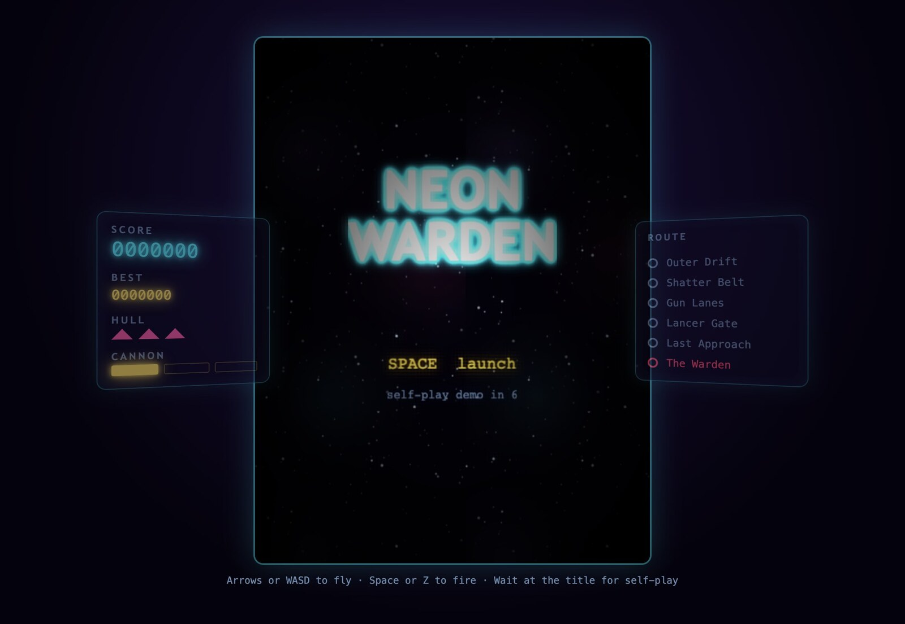
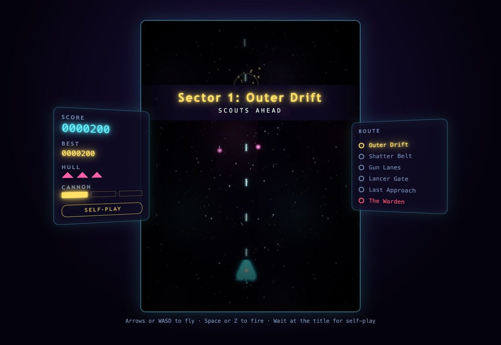
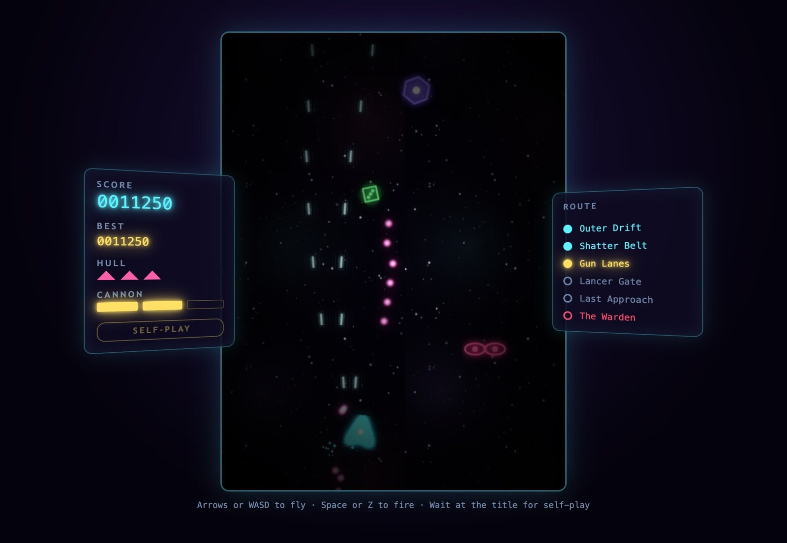
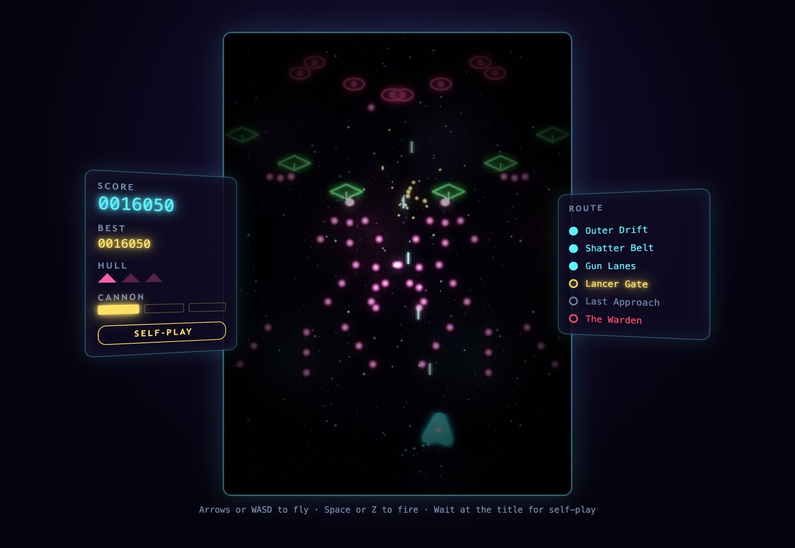
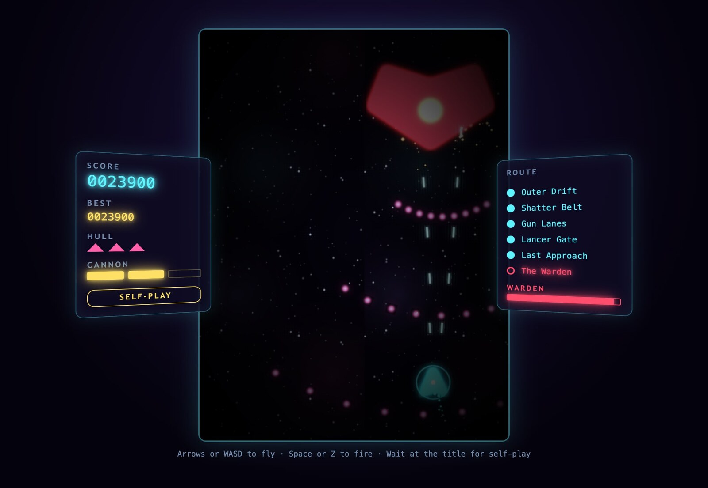
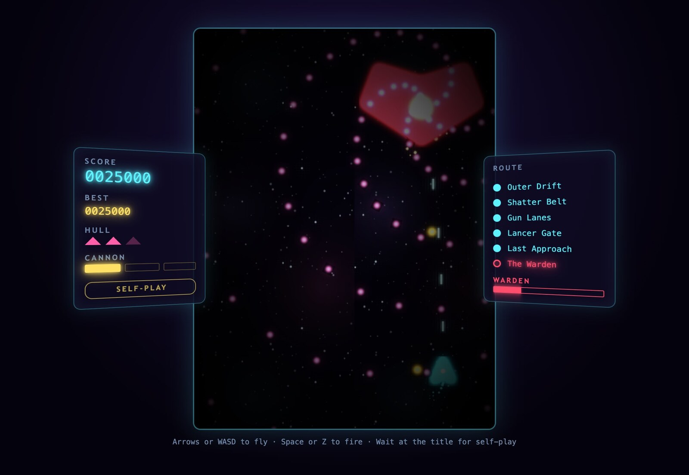
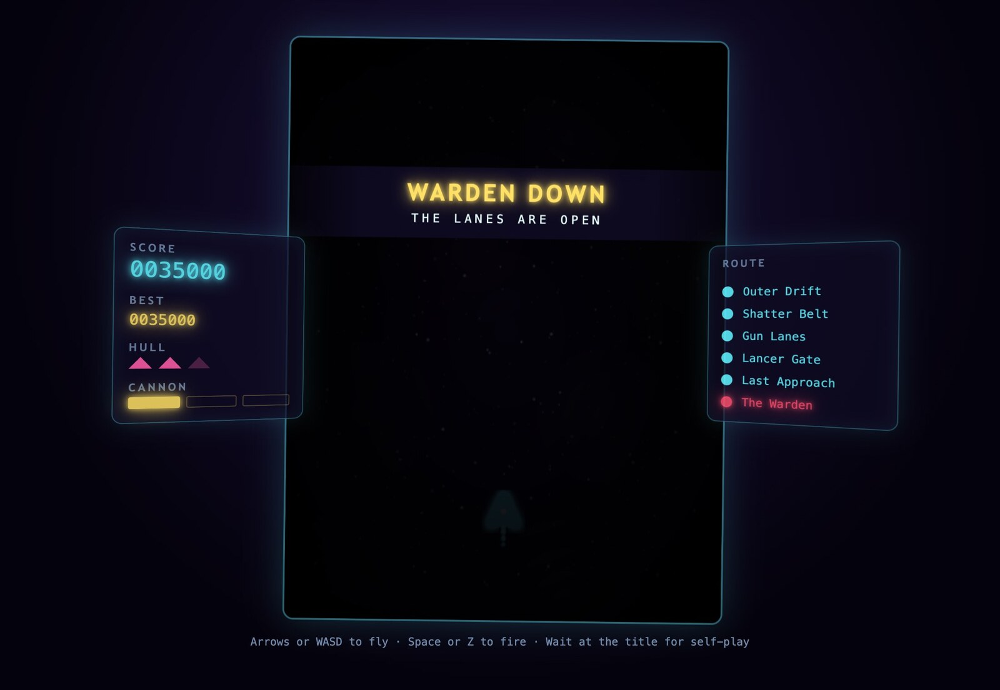
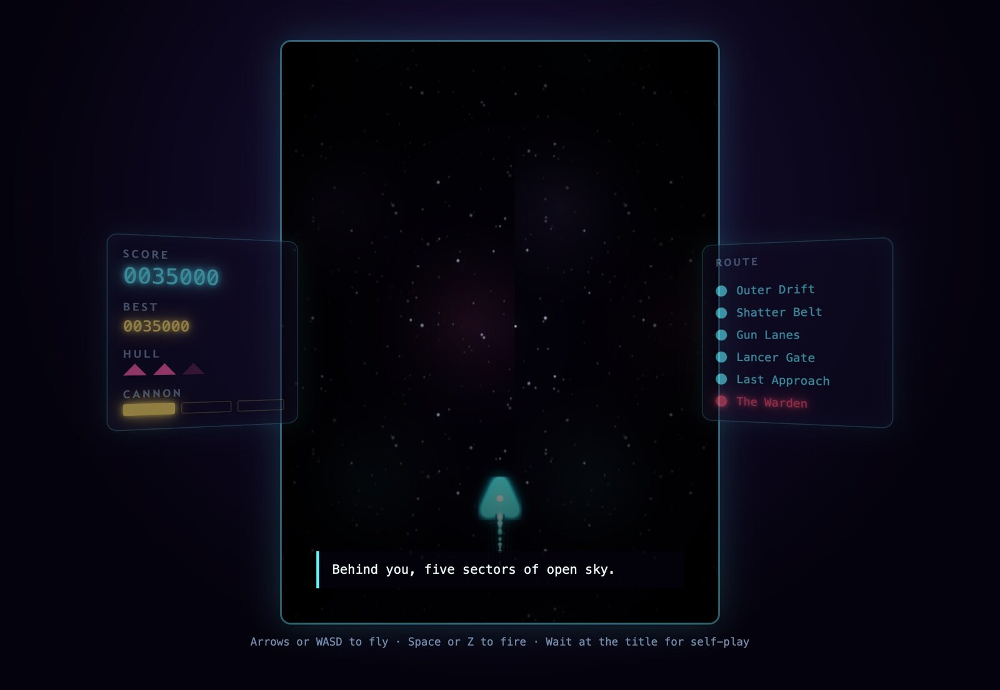

# Neon Warden (original): design reference for the AAAA remake

**Framing question.** What exactly is in the original Phaser *Neon Warden* (entities, looks, behaviors, waves, HUD, sound, palette, text), and how could each piece be reinterpreted as a speculative-2027 3D asset for the three.js remake without losing what made it readable?

**Sources.** Read-only copy of the starter in [`reference/e4-starter/src/`](../../reference/e4-starter/src/) (all `.ts` files and [`style.css`](../../reference/e4-starter/src/style.css)); live build at <https://ucsc-cmpm-121-f26.github.io/e4-starter/>.

**Status (October 28, 2026).** Every source file was read in full. Screenshots were taken from the live build: the OpenChamber browser panel throttled its background tab (the game loop stalled at score 0), so gameplay frames were captured instead with headless Playwright Chromium running `?attract&speed=3` (seed 121) and sampled every 2.5 s; 8 of 43 frames were kept. That run ended with the console line `[self-play] seed=121 ticks=17922 score=35000 kills=162 hits=6 continues=1`. Game over was not captured, because self-play never ends early (it buys a continue instead); its text is quoted from source below.

## Screenshots

| | |
| --- | --- |
|  **01 Title.** Cabinet layout: tilted Score/Hull/Cannon panel left, Route panel right, glowing NEON WARDEN wordmark. |  **02 Sector 1: Outer Drift.** Flip-down banner, first drone line, twin cannon. |
|  **03 Gun Lanes.** Violet hex turret firing an aimed stream, green spread pickup falling, pink drone pair. |  **04 Lancer Gate.** Green lancers crossing from both walls, three-way pink curtains. Densest pre-boss frame. |
|  **05 Warden arrives.** Crimson hull descends, invulnerable for 150 ticks; nine-bullet fan. |  **06 Warden phase 3.** Four-arm rotating spiral plus gold heavy shots. |
|  **07 WARDEN DOWN.** "The lanes are open." Bullets and escorts are wiped. |  **08 Epilogue caption.** "Ahead, the long way home." Then a warp jump and credits. |

## Entity bible

Coordinates are in the original 480 × 640 playfield; one tick is 1/60 s. "Drop" is the chance of a power-up on kill. Every texture is drawn procedurally to a canvas ([`textures.ts`](../../reference/e4-starter/src/textures.ts)) as neon strokes (8 px shadow blur) over a translucent fill, then bloomed by the camera. The project ships no image files at all.

| Entity | Original look | Behavior (from source) | Speculative-2027 3D reinterpretation | Poly / material notes |
| --- | --- | --- | --- | --- |
| **Player ship** (`player`) | 48 px cyan `#5ef2ff` kite/arrowhead outline, 25% cyan fill, white cockpit dot; cyan glow filter; spark engine trail | Speed 4.2 px/tick, clamped to the screen; banks ±0.18 rad with horizontal input. Fires every 7 ticks; shots at 11 px/tick upward. Power 1–3: 1, 2 (±0.8 vx) or 3 (−1.6, 0, 1.6 vx) parallel shots. Collision radius only 6 (a tiny hitbox inside a big sprite). A hit costs one power level and one life and grants 120 ticks of blinking grace. | Delta-wing interceptor with a canopy that is visibly over-engineered: articulated canards, a gimballed thrust ring, a glass cockpit with a modeled pilot seat nobody will ever see. The 2D kite silhouette must survive from the top-down camera. | Hero asset, so lean into parody: about 40k tris, PBR carbon-weave hull, emissive cyan edge-trim strips (keep them as a separate emissive material for bloom), a separate cockpit glass material. Bank as a root rotation. Keep the hitbox tiny and show it (a glowing core gem) as in modern bullet-hell. |
| **Shield bubble** (`bubble`) | 64 px cyan ring at 80% alpha, rotating 0.05 rad/tick | Absorbs one hit with no life or power lost, then still grants grace | Hexagonal-cell energy sphere with a Fresnel rim and a crackle on impact | Icosphere (subdivision 3), additive Fresnel shader; no glTF material needed beyond a placeholder |
| **Player shot** (`shot`) | 8 × 22 px pale cyan `#c8fbff` bar, additive | Straight up, 11 px/tick, damage 1, radius 6 | Plasma bolt: a stretched emissive capsule with a short trail | Instanced; 12-tri billboard or 48-tri capsule; pure emissive |
| **Drone** (`drone`) | 36 px hot-pink `#ff5ea8` horizontal ellipse ring (14 × 8) with a solid pink core dot | HP 2, score 100, radius 13, drop 1.5%. Falls 1.5 px/tick while weaving ±46 px on a sine (alternating direction by spawn index). Every 100 ticks, a 35% chance to fire one aimed bullet at 2.4. The workhorse: also summoned by the Warden. | Saucer-like scout pod: a horizontal torus ring around a glowing eye, with tiny stabilizer fins. Reads as an "eye," which feeds the surveillance theme. | About 2–4k tris (many on screen; instance it). Gunmetal body, pink emissive ring and core. |
| **Dart** (`dart`) | 36 × 40 px amber `#ffb84d` downward chevron/arrowhead, 30% amber fill | HP 1, score 150, radius 12, drop 1.5%. Drifts in at 1.2 px/tick for 50 ticks, then commits: dives at 5.2 px/tick, sliding 1.4 px/tick toward the player's side. Unarmed (its weapon is commented out in source). | Kamikaze lancet: a narrow swept blade with an exposed thruster, visibly unarmed. Telegraph the commit with a thruster flare at tick 50. | About 2k tris, brushed-amber anodized metal, emissive thruster |
| **Turret** (`turret`) | 48 px violet `#9d7bff` hexagon outline, 25% violet fill, white core; slowly rotates | HP 12, score 400, radius 19, drop 30% (the main power-up source). Descends 70 ticks, holds, spins 0.02 rad/tick; from tick 80 fires aimed bullets at 3.4 every 8 ticks during 40 of every 100 ticks; leaves after tick 420. | Orbital gun platform: hexagonal armored drum with a rotating six-barrel crown and a white reactor core; deploys stabilizer legs on arrival | About 6–8k tris, matte violet ceramic armor, white emissive core, animated crown (separate node) |
| **Lancer** (`lancer`) | 52 × 28 px green `#7dff9b` horizontal diamond with a short downward "lance" line | HP 4, score 250, radius 15, drop 6%. Enters from a side wall at y 70–220, crosses at 2.4 px/tick (drifting down 0.35); every 40 ticks fires a three-way spread (±0.25 rad) downward at 2.6. Always arrives in mirrored pairs ("pincer"). | Side-scrolling lance frigate: a long flat diamond hull with a ventral spike emitter, a heraldic jousting knight in profile | About 4–6k tris, green enamel with gold trim, emissive ventral spike |
| **Enemy bullet** (`bullet`) | 16 px radial gradient: white center, pink `#ff7bd5`, fading out; additive | Radius 5, straight line | Glowing pink plasma orb; must stay maximally readable (the AAAA parody can bury it in particles, but gameplay should not) | Instanced sprite or 80-tri sphere, emissive, additive |
| **Heavy bullet** (`heavy`) | 24 px gradient, gold `#ffd24d` | Radius 8; Warden only (aimed volleys) | Larger gold slug with a heat-shimmer halo | As above |
| **Spread power-up** (`spread`) | 28 px green `#7dff9b` diamond outline with three dots in a row | Falls 1.1 px/tick, spins 0.04 rad/tick, pulses ±12% scale. +1 cannon power (max 3). Dropped 50% of the time while power < 3. | Floating data-crystal or weapon cartridge in a holographic diamond cage | Low poly (under 1k), emissive green, rotating |
| **Shield power-up** (`shield`) | 28 px cyan `#5ef2ff` diamond outline with a small ring inside | As above; grants the shield bubble. Always shield once power is 3. | Same cage, cyan, with a ring core | As above |
| **The Warden** (`boss` + `boss-core`) | 200 × 140 px crimson `#ff4d6d` six-sided shield/chevron (a downward heart or crest shape), 18% fill, inner ring (r 34) and a horizontal bar; pulsing gold `#ffe066` radial core | HP 900, score 10,000, radius 46. Descends 1.4 px/tick for 150 ticks, ignoring all damage. Then sways ±140 px (faster in phase 3). **Phase 1** (HP > 2/3): nine-bullet fan every 55 ticks. **Phase 2:** wider fan every 80, a three-bullet aimed heavy volley offset by 40, and every 360 ticks summons two drones as escorts. **Phase 3** (HP < 1/3): four-arm rotating spiral every 6 ticks plus an aimed heavy every 48. Core pulse rate scales with phase. Death: 8 chained blasts over 1.1 s, then a big flash. | A cathedral-scale gatekeeper: a crest-shaped armored bulwark with a caged sun for a heart. The crest silhouette should be preserved (it already reads as a shield or a badge, which is the point: a warden). The ring becomes a rotating halo; the bar a sealed blast door. Phase transitions shed armor plates to expose more of the core. | Showpiece: 150–300k tris (parody-justified), separate meshes for armor plates (phase breakaway), halo ring, blast-door bar and core; crimson lacquer with heavy clearcoat, gold emissive core. Shape keys or plate nodes for damage states. |
| **FX** (`spark`, `ring`, engine trail) | 8 px white glow dots tinted per event; 64 px white ring that expands and fades | Hit sparks (3), pickup burst (14), hurt burst (24), explosion = sparks plus an expanding ring; size 3 for the Warden | GPU particles, shockwave distortion rings, debris meshes | Shader work, not Blender, except optional debris chunks |
| **Backdrop** (`nebula`, `stars-far`, `stars-near`) | Three nebula blobs (violet, pink, cyan at 10–16% alpha) and two seeded star layers; parallax at 0.25, 0.6, 1.6 px/frame; camera bloom (threshold 0.55) and vignette | Pure scenery. The cutscene ramps scroll speed to 18× for a warp jump. | Volumetric nebula and a real 3D starfield flown through; optional megastructure silhouettes (the "lanes") | Skybox plus particle layers; no hero modeling |

### "Pilots" are not characters (yet)

In [`pilots.ts`](../../reference/e4-starter/src/pilots.ts) a "pilot" is an interface: anything that reads a `Cockpit` (player, enemies, threats, pickups) and returns `Controls`. There are two: `KeyboardPilot` (a person) and `AutoPilot` (deterministic self-play that steers toward targets and pickups and away from predicted threat positions 0–20 ticks ahead). There are no named pilot characters. This is an unclaimed narrative slot; see hooks below.

## Waves and progression

Route (shown in the right HUD panel): **Outer Drift, Shatter Belt, Gun Lanes, Lancer Gate, Last Approach, The Warden.** Each sector advances once its minimum time has passed and the screen is clear, or at a hard cap. Spawn formations are lines (64 px spacing), vees (44 px, staggered 10 ticks), columns (24-tick stagger), and side pincers.

| # | Sector | Banner subtitle | Min–cap (ticks) | Composition |
| --- | --- | --- | --- | --- |
| 1 | Outer Drift | "Scouts ahead" | 1560–1800 | Drones only: line 4, vee 5, vee 5, line 6, two columns of 4 |
| 2 | Shatter Belt | "Divers incoming" | 1800–2040 | Drone vee 6, dart line 4, two dart columns of 5, drone line 7, dart vee 5, dart line 6 |
| 3 | Gun Lanes | "Turrets online" | 1920–2160 | Turret 1, drone vee 6, turrets 2, dart column 6, turrets 2, drone line 6, turrets 3 |
| 4 | Lancer Gate | "Crossfire" | 1920–2160 | Lancer pincer 4, dart vee 6, lancer pincer 6, turrets 2, lancer pincer 6, drone vee 8, dart line 8 |
| 5 | Last Approach | "Everything they have" | 2040–2280 | Turrets 3, lancer pincer 6, twin dart columns of 6, drone vee 9, turrets 2, lancer pincer 8, dart vee 8 |
| 6 | The Warden | "WARNING / The Warden approaches" (cabinet quake, warning siren) | 200-tick warning, then the boss | See the Warden row above |

Pre-boss run: roughly 9,200–10,400 ticks, so about 2.5–3 minutes of real play.

## Gameplay loop and modes

- **Modes:** `title` → `play` or `attract` → `cutscene` → `title`. Each switch is a 450 ms camera fade and scene restart.
- **Title:** the wordmark NEON / WARDEN (Orbitron, 64 px, cyan glow, slow breathing scale), "SPACE launch" in gold, and a countdown "self-play demo in N" from 8 seconds.
- **Attract (self-play):** `AutoPilot` flies; a blinking SELF-PLAY badge appears; any Space returns to the title. Deterministic from a seeded mulberry32 RNG ([`rng.ts`](../../reference/e4-starter/src/rng.ts)); URL switches `?attract&speed=1–8&seed=N`. Self-play never game-overs: on zero lives it silently buys a continue.
- **Play:** 3 lives (Hull pips). Getting hit (bullet or body contact) costs a life and a cannon level unless shielded; ramming also deals 3 damage to the enemy. Game over shows "GAME OVER / The lanes stay closed," then the title.
- **Scoring:** drone 100, dart 150, lancer 250, turret 400, Warden 10,000. No multipliers, no combo, no grazing. Score is padded to seven digits; Best persists only for the page session.
- **Victory:** "WARDEN DOWN / The lanes are open," chained explosions, then the cutscene.
- **Cutscene (the whole existing story):** captions at 0.8 s, 4.2 s and 7.6 s: *"The Warden's lights go dark, one ring at a time." / "Behind you, five sectors of open sky." / "Ahead, the long way home."* At 9 s a warp jump (scroll ×18, ship shrinks away, white flash); at 11 s "THANK YOU FOR PLAYING / Final score N" (plus a self-play stats line in attract mode); back to the title at 18 s.

## HUD

Ordinary HTML around the canvas ([`hud.ts`](../../reference/e4-starter/src/hud.ts), [`style.css`](../../reference/e4-starter/src/style.css)), styled as an arcade cabinet: side panels tilt 24° toward the screen (`perspective: 900px`) and dim to 55% opacity on the title and cutscene.

- **Left panel, "Ship status":** SCORE (cyan, 22 px, double glow), BEST (gold, 15 px), HULL (three pink triangle pips), CANNON (three gold cells), SELF-PLAY badge (gold, blinking).
- **Center:** 480 × 640 screen with a cyan rim glow; a **banner** that flips down on a perspective X rotation (2.6 s) for sector titles; a **caption** box with a cyan left rule for story text.
- **Right panel, "Route":** six stops with dot states `ahead` (grey), `current` (gold, pulsing), `cleared` (cyan, filled); the last stop is always crimson. A crimson WARDEN meter appears during the fight.
- **Impact feedback:** the whole cabinet `shudder`s (260 ms) on a shielded hit and `quake`s (520 ms) on a life lost, the boss warning and the Warden's death, alongside camera shake and flash in the canvas.
- Help line: "Arrows or WASD to fly · Space or Z to fire · Wait at the title for self-play".

## Sound

All synthesized at boot into 22,050 Hz mono WAVs ([`sounds.ts`](../../reference/e4-starter/src/sounds.ts)): `shoot` (70 ms falling square chirp), `hit` (60 ms noise tick), `boom` (0.45 s noise plus falling triangle), `bigboom` (1.6 s), `pickup` (0.3 s square arpeggio 660–880–990–1320 Hz), `hurt` (0.4 s falling square plus noise), `warn` (1.2 s two-tone 440/330 Hz siren). A `music` recipe exists (an 8 s minor-key bass arpeggio over roots A2, F2, C3, G2 with a soft pad) but is never played. That unplayed track is a gift for the parody: "the lost original score."

## Palette

There are no CSS custom properties in the original (the only one is `--fill`, the boss meter's 0–1 scale). Colors are literals in `textures.ts` and `style.css`.

| Role | Hex | Used for |
| --- | --- | --- |
| Void | `#04020c` | Canvas background, fade color, body gradient edge |
| Deep violet | `#1a0f3a` | Body radial gradient center |
| Panel | `rgba(14, 10, 34, 0.86)` (about `#0e0a22`) | HUD panels, banner backing |
| Ice white | `#e8fdff` | Body text, title wordmark fill |
| Cyan (player, shield) | `#5ef2ff` | Ship, shield, score, cleared stops, panel borders, glows |
| Pale cyan | `#c8fbff` | Player shots |
| Hot pink (drone) | `#ff5ea8` | Drones, Hull pips |
| Enemy-shot pink | `#ff7bd5` | Enemy bullets |
| Amber (dart) | `#ffb84d` | Darts |
| Violet (turret) | `#9d7bff` | Turrets, nebula blob |
| Mint green (lancer, spread) | `#7dff9b` | Lancers, spread pickup |
| Crimson (Warden) | `#ff4d6d` | Warden hull, boss meter, final route stop |
| Gold (core, UI accent) | `#ffe066` | Warden core, Best, Cannon cells, banners, current stop, badge |
| Heavy-shot gold | `#ffd24d` | Heavy bullets |
| Spark cream | `#ffe8b0` | Hit sparks |
| Slate (labels) | `#6f86a8` | Panel headings, inactive stops, help line |
| Slate light | `#8aa4c8` | Title countdown |

Fonts: Orbitron (titles, labels; falls back to Trebuchet MS) and JetBrains Mono (body, readouts).

## Narrative hooks the parody can over-inflate

Ranked roughly by comedic and thematic yield for the required beats (flashback, Warden boss, morally gray ending).

1. **"Warden" and "the lanes stay closed."** The game-over line implies the Warden *closes lanes*: it is a guard, not an invader. Victory reads "The lanes are open." This is the seed of the morally gray ending: what was the Warden keeping in, or out? The Warden is also the only thing on the HUD with a name.
2. **The Warden's invulnerable descent.** It literally cannot be harmed for 150 ticks while it arrives: a scripted grace period that the remake can play as the Warden *giving a speech* (over-acted boss beat), or as it refusing to fight until it has finished its warning.
3. **The Warden summons drones in phase 2.** The drones that opened the game are its own scouts; the "enemies" were patrols. Escorts die with it ("The Warden's fall takes its bullets and escorts with it"): they were extensions of it.
4. **The epilogue's three lines.** "The Warden's lights go dark, one ring at a time" / "Behind you, five sectors of open sky" / "Ahead, the long way home." Already elegiac; inflate into a 40-minute ending with doubt. Why is home the *long* way? What were the rings?
5. **The route names as places with history.** Outer Drift, Shatter Belt, Gun Lanes, Lancer Gate, Last Approach: a whole fictional geography with zero lore. Each can get a codex entry, a faction, and a loading-screen paragraph.
6. **Banner subtitles as faction voice.** "Scouts ahead," "Divers incoming," "Turrets online," "Crossfire," "Everything they have." Who is "they"? The last one implies the Warden's side is out of resources: a defender's last stand.
7. **The pilot is an interface.** No pilot is named; the code's `Pilot` is "anything that can fly the ship: a person at the keyboard or the autopilot." The `AutoPilot` plays the game perfectly and deterministically when nobody is watching and "buys another ship" whenever it dies. Parody options: the player character is the autopilot; or the flashback reveals the hero has been replaced by an autopilot all along; continues are clones.
8. **`Cockpit`, `Arena`, `summon`.** The Warden's world is an "arena" whose interface lets actors `fire` and `summon`: a gladiatorial or ritual framing for the whole conflict.
9. **Cut content, played as archaeology.** The dart's commented-out gun ("darts used to shoot"), the "old sector 3 opener" `spawnTurret`, the never-played `music` track, comments that disagree with code ("pair of turrets" spawns three, "six lancers" spawns four, "sector 4 is sector 3 but faster," which it is not), `summon(kind)` ignoring `kind` (the Warden can only ever summon drones), and the victory-lap invulnerability that never triggers because of the typo `bossDefeted`. These are the starter's deliberate mess for students, and an AAAA parody can treat them as "restored cut content" DLC or in-universe glitches in the Warden's systems.
10. **"THANK YOU FOR PLAYING."** Set against the pacifist-run ending, this can become accusatory or sarcastic.
11. **First power-up, mint green "spread."** The required flashback triggers here. The spread pickup is a three-dot crystal: inflate it into a memory core containing the pilot's first deployment.

## Options for the remake's visual translation

- **A. Faithful silhouettes, AAAA materials (recommended).** Keep every 2D outline readable from a top-down or slight-perspective camera; add PBR detail, emissive trim matching the original hex values, and bloom. Pros: the parody joke ("same game, 1000× the budget") lands only if the player recognizes the original; readability survives. Cons: modeling must respect silhouette constraints.
- **B. Full redesign.** Treat names and behaviors as the only canon. Pros: more freedom for Blender agents. Cons: loses the side-by-side comedy, risks muddy bullet readability.
- **C. Hybrid camera.** Gameplay top-down with faithful silhouettes; cinematics (logos, flashback, boss intro, ending) use dramatic close-ups where redesign detail shows. Pros: best of both. This pairs naturally with A.

## Next step

Hand the entity bible rows to Blender agents one asset at a time, starting with the drone (simplest, most instanced, and the Warden's own scout), with the hex palette as emissive targets and a silhouette check: render the glTF top-down at 48 px and compare against the original sprite.
